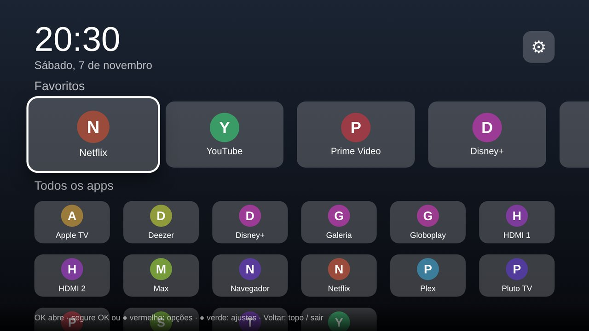

# Launcher TV para LG (webOS)

Versão do Launcher TV para TVs LG com webOS (2014 em diante): relógio, favoritos e uma grade
de apps e entradas (HDMI), navegável pelo controle. A interface é a mesma da versão Samsung
(pasta [`web/`](../web)); só o adaptador [`platform.js`](platform.js) é da LG.



> **Como na Samsung, a LG não deixa trocar a tela inicial** nem desativar apps do sistema.
> O Launcher TV é um app que você abre pela barra de apps (dá para movê-lo para o começo dela).

## Controle

| Tecla | Ação |
|---|---|
| Setas + **OK** | Navegar e abrir app |
| **Segurar OK** ou botão **vermelho** | Fixar/remover dos favoritos, mover, ocultar |
| Botão **verde** ou ⚙ | Ajustes: apps ocultos, segundos no relógio, organização padrão, sair |
| **Voltar** | Volta ao topo; no topo, fecha o app |

O ponteiro do Magic Remote não é usado: navegue pelas setas.

## Quais apps aparecem

A LG normalmente não deixa apps de desenvolvedor lerem a lista de apps instalados. Então:

1. O launcher **tenta** ler a lista real da TV. Se a LG permitir, mostra exatamente o que está instalado.
2. Se não permitir, usa um **catálogo** dos apps mais comuns na LG (Netflix, YouTube, Prime Video,
   Disney+, Apple TV, Spotify, TV ao vivo, HDMI 1-4, Navegador, LG Content Store, Configurações).
   Um app do catálogo que não abrir é considerado não instalado: **some sozinho**, com um aviso.
   *Ajustes → Mostrar apps ocultos* traz todos de volta.

Para incluir outro app no catálogo, acrescente uma linha `['id.do.app', 'Nome']` em
[`platform.js`](platform.js). O ID aparece com `ares-launch --device lgtv --running` com o app aberto.

## Instalar

### 1. Computador

- [Node.js](https://nodejs.org) e o CLI da LG: `npm install -g @webos-tools/cli`

### 2. TV em Modo Desenvolvedor

1. Crie uma conta em [webostv.developer.lge.com](https://webostv.developer.lge.com) (grátis).
2. Na TV, instale o app **Developer Mode** pela LG Content Store e entre com essa conta.
3. Ligue **Dev Mode Status** (a TV reinicia) e depois **Key Server**.
4. Anote o **IP** e a **Passphrase** que o app mostra.

### 3. Instalar

```bash
./webos/build.sh install <ip-da-tv>      # pede a Passphrase na primeira vez
```

O script cadastra a TV no `ares`, empacota (`webos/build/*.ipk`), instala e abre o app.
O `.ipk` pronto também sai no GitHub em **Actions → build → launcher-tv-webos**
(instale com `ares-install --device lgtv arquivo.ipk`).

## Limitações conhecidas

- Não substitui a tela inicial da LG nem desativa apps ou anúncios do sistema.
- **A sessão do Modo Desenvolvedor expira** (o app Developer Mode mostra o tempo restante e tem
  o botão *Extend*). Se expirar, os apps instalados por ele somem: reinstale com o `install`.
- Sem acesso à lista real, os ícones não aparecem: os blocos mostram a inicial colorida.
- Ainda não foi testado numa TV LG real (só no navegador, simulando as APIs da LG).

## Menos rastreamento na LG (pelo controle)

Configurações → Geral → **Sistema → Informações adicionais → Contratos de usuário**
(o caminho varia por ano):

- desligue **Live Plus** (reconhece o que passa na tela, inclusive nas entradas HDMI);
- recuse **Viewing Information** e **Interest-Based Recommendation**;
- em *Publicidade*, ligue **Limitar o rastreamento de anúncios**.
